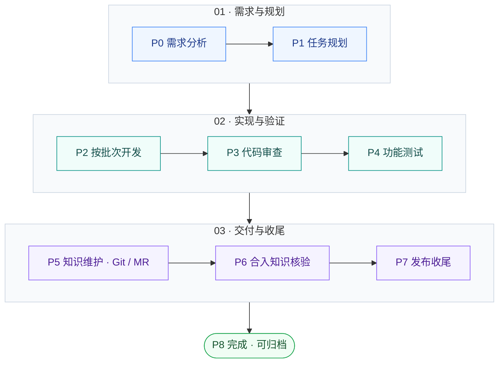
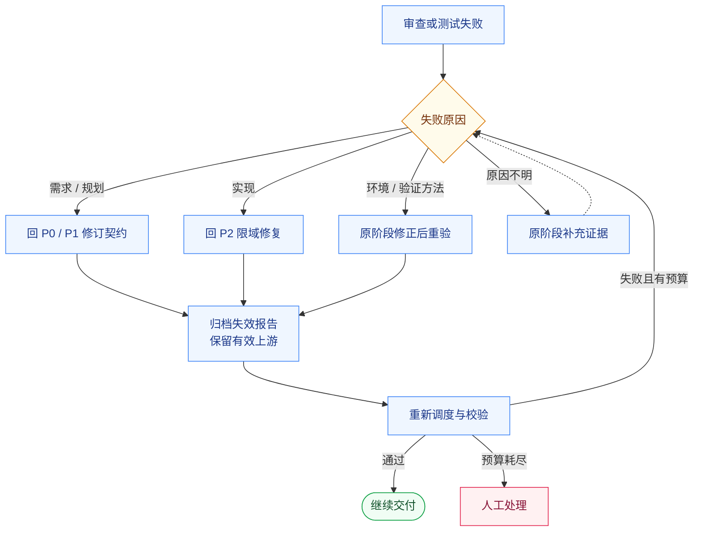

# FullstackFlow

面向 Claude Code / CodeBuddy Code 的全栈研发工作流插件。用 `/fsflow:run` 启动需求开发，
或用 `/fsflow:fixbugs` 修复缺陷，串联需求、规划、开发、审查、测试和交付。

当前版本 **1.4.0** · 插件运行时无需 `npm install` · 支持前端、后端与多仓库任务

[快速上手](#快速上手) · [研发流程](#研发流程) · [执行与恢复](#执行与恢复) · [知识维护](#知识维护) · [安装与排障指南](INSTALL.md)

## 快速上手

准备 Claude Code 或 CodeBuddy Code、Node.js 18+ 和 Git 2.20+。
模型访问、业务项目依赖和测试环境由宿主及项目配置提供。

```text
/plugin marketplace add AbyssPan/fullstackflow
/plugin install fsflow@fullstackflow-marketplace
```

安装后重载插件，用 `/plugin list` 确认 `fsflow` 已启用。

```text
/fsflow:run "开发订单中心退款功能"
/fsflow:fixbugs "订单列表页白屏"
/fsflow:status
```

也可以直接说「开发退款功能」「修复订单列表报错」。首次需求分析会检查项目知识库，
缺失时询问是否初始化；已有知识库直接复用。

| 命令 | 用途 |
|---|---|
| `/fsflow:run [storyId] "<需求>"` | 开发新功能或改造现有功能 |
| `/fsflow:fixbugs [storyId] "<缺陷>"` | 分析根因并修复，可附 TAPD 信息 |
| `/fsflow:status` | 查看当前任务、阶段和阻塞项 |
| `/fsflow:end` | 结束激活会话并解除编辑门控，保留任务 |
| `/fsflow:evolve [storyId\|all] [--check-only\|--propose-only]` | 工作流体检与改进建议 |
| `/fsflow:archive <storyId> <archive\|restore\|list\|status>` | 归档、恢复或查看历史 |

`storyId` 可由入口自动生成；归档命令需要明确指定任务与动作。
兼容入口 `/fsflow:fullstack <run|fixbugs|status|end|evolve|archive> ...` 仍可使用。

## 研发流程

P0–P7 为执行阶段，P8 为完成态。每次推进由脚本复核产物与门控，角色之间通过契约和交付证据协作。



| 阶段 | 负责角色 | 主要结果 |
|---|---|---|
| P0 需求分析 | 需求分析师 | 需求边界、验收标准（AC）、待确认事项 |
| P1 任务规划 | 任务规划师 | 任务 DAG、开发批次、文件范围、Figma 节点绑定 |
| P2 代码开发 | 全栈开发工程师 | 代码、自测证据、按任务保存的交付说明 |
| P3 代码审查 | 代码审查师 | 问题清单、逐文件覆盖与版本证据 |
| P4 功能测试 | 测试工程师 | AC 验证结果、失败或无法验证的原因 |
| P5 知识维护与 Git/MR | 发布助手 | 提交前更新知识，代码与知识进入同一 MR |
| P6 合入知识核验 | 发布助手 | 核验实际合入版本及知识维护回执 |
| P7 发布收尾 | 发布助手 | 前端云端构建与部署结果；后端确认合并后收尾 |

**测试选择**：新任务默认在代码审查后询问是否执行独立功能测试。已明确选择时沿用选择，
恢复与返修不重复询问。跳过会留痕，不能记为测试通过，也不会取消代码审查或项目原有检查。

**质量检查**：JSON Schema 校验产物格式，门控检查功能点 → AC → Task 关联，
审查核对文件覆盖及证据版本。开发完成后对变更前端文件执行增量 ESLint；未安装 ESLint 时警告并跳过。
本地前后端编译默认关闭，设 `HARNESS_RUN_BUILD=1` 启用；执行失败或无法确认成功时阻止推进。

**编辑与发布**：开发阶段的 dev-pass 将已登记仓库 `src/` 编辑限定在任务文件范围内，结束后撤销。
Hook 覆盖文件工具与常见 shell 写入，不能替代宿主权限控制或代码审查。
Git/MR 与发布动作沿用已有授权，缺少授权时在执行前确认；跳过交付步骤须记录用户决定。

## 执行与恢复

### 轻量准备

新任务默认 `workflowProfile: "auto"`。单仓、低风险、1–3 个明确文件，且不涉及跨模块、
接口、依赖、数据迁移、权限变化或 Figma 强制还原时，需求分析可同时产出最小任务规划。
P0/P1 门控仍逐一执行，独立审查和测试选择保持有效。

指定 `full` 保留独立规划；`light` 仍需满足上述条件，证据不足时使用完整路线。

### 按批次开发与按需读取

- 规划包含批次时，脚本按 `batchId` 顺序生成各批的任务、仓库、文件范围和关联 AC，主 Agent 原样下发。
- 批次之间串行；某批失败时停止后续批次。全部任务实际完成后才记录开发阶段完成。
- 交付说明写入 `development-notes/<taskId>.md`。恢复执行时先核对源码版本与证据，不凭文件存在认定完成。
- 阶段产物需要修订时，只补门控指出的缺口；实现返修优先读取本轮问题清单，再按需读取关联任务、AC、设计节点和调用方。
- 无批次的旧任务沿用单 Agent 执行；返修不重新下发完整开发批次。上下文裁剪不降低验收与审查覆盖要求。

### 失败恢复



代码审查与功能测试各默认最多 2 轮恢复，独立计数。实现返修须产出匹配本轮问题的
`fix-verification.json`，旧报告不能代替本轮结果。

继续同一未完成任务时复用原 Story，保留契约、测试选择与预算；已归档任务先恢复。
新需求或新缺陷应新建 Story。

### 执行度量

每个 Story 目录提供 `workflow-metrics.md` 和 `workflow-metrics.json`，展示阶段耗时、
Agent 调用、返修、模型与 Token 采集情况，随执行事件更新。

```bash
node "${CLAUDE_PLUGIN_ROOT}/scripts/commands/workflow-metrics.js" <storyId> --write
```

实际模型与 Token 只取宿主上报值，缺失显示「未采集」。阶段耗时包含等待，Agent 耗时为调用累计；
报告不包含未采集的主控用量，不能当作完整账单。

## 知识维护

知识与代码同仓，存放在 `.docs/llm-knowledge/`，随 Git 分支维护对应版本。
`kb-query` 定位业务与历史经验，再以源码和按需 LSP 查证调用关系。

P5 提交前用 `kb-update` 更新受影响业务域，或记录明确延期；代码、知识与回执一起提交。
P6 核验实际合入版本，复用已有维护结果。

首次初始化后，可安装项目维护运行时与当前 clone 的 Git hook：

```bash
node "${CLAUDE_PLUGIN_ROOT}/scripts/commands/kb-maintenance.js" install
node .docs/llm-knowledge/tools/fsflow-kb/commands/kb-maintenance.js install --hooks
```

提交前可执行严格检查：

```bash
node .docs/llm-knowledge/tools/fsflow-kb/commands/kb-maintenance.js check --staged --strict
```

Git hook 不随 clone 自动安装；已有 Husky 或自定义 hook 时需按指南接入。
GitLab 候选合并检查用于发现并行 MR 合并后的知识遗漏。
配置、CI 模板与延期回执见 [安装指南](INSTALL.md#同仓知识维护与-git-hook)。

`changelog/` 的独立审查片段可在发布或例行维护时清理：

```bash
node .docs/llm-knowledge/tools/fsflow-kb/commands/kb-maintenance.js prune --base origin/main
node .docs/llm-knowledge/tools/fsflow-kb/commands/kb-maintenance.js prune --base origin/main --apply
node .docs/llm-knowledge/tools/fsflow-kb/commands/kb-maintenance.js history --scope domain:order --limit 20
```

`origin/main` 替换为实际目标分支并事先更新引用。默认只预览；显式执行仅删除已合入基线且能证明被后续回执替代的旧片段，不自动暂存或提交。当前回执与片段、延期记录、未合并及无法核实的记录保留；完整历史通过 Git 查询。已有项目需从更新后的插件重跑 `install` 才能使用新命令。详见 [生命周期与保留规则](plugins/fsflow/skills/kb-update/references/maintenance.md#changelog-生命周期与历史查询)。

## 能力与集成

插件包含 6 个角色 Agent 与 16 个 Skill。模型配置位于各 Agent 文件中，需与宿主支持的模型匹配。

| 能力 | Skill |
|---|---|
| 工作流 | `harness-start`、`harness-conductor`、`harness-evolve`、`harness-archive` |
| 知识库 | `kb-init`、`kb-query`、`kb-update`、`gen-project-docs` |
| 开发与验证 | `frontend-tech-spec`、`backend-tech-spec`、`code-review`、`systematic-debugging`、`test-design-and-execution` |
| 辅助工具 | `api-generator`、`figma-to-component-map`、`tapd-bug-analyzer` |

<details>
<summary>角色注册名与配置模型</summary>

| 角色 | 注册名 | 配置模型 |
|---|---|---|
| 代码审查师 | `code-reviewer` | `GLM-5.3` |
| 任务规划师 | `task-planner` | `GLM-5.3` |
| 全栈开发工程师 | `fullstack-developer` | `GLM-5.3` |
| 发布助手 | `release-assistant` | `hy3` |
| 测试工程师 | `test-engineer` | `deepseek-v4.1-flash` |
| 需求分析师 | `requirement-analyst` | `deepseek-v4.1-flash` |

以上是配置值，实际使用模型以宿主返回为准。

</details>

按任务需要配置外部服务：

| 服务 | 用途 |
|---|---|
| Figma MCP | 规划时读取相关节点，开发时拉取完整设计上下文 |
| TAPD | 导入需求与缺陷 |
| GitLab MCP | 管理 MR |
| devops MCP | 前端云端构建与部署 |
| Playwright MCP | 前端浏览器实跑验证 |

`run` 提供 Figma 链接时启用设计契约门控；`fixbugs` 不启用全量设计门控，但涉及 UI 的修改仍需核对设计。
按当前 Figma 接入方式，桌面端需运行并打开对应文件。缺少必需服务时报告阻塞；测试环境缺失可记录
`unverifiable`，不得声称验证通过。

## 开发与排障

```bash
cd plugins/fsflow
npm run verify
```

验证包含插件结构一致性检查和全部回归测试。插件内置 JSON Schema 校验依赖，无需单独安装 OpenSpec CLI。

| 目录 | 内容 |
|---|---|
| `plugins/fsflow/commands/` | 斜杠命令入口 |
| `plugins/fsflow/agents/` | 角色职责与模型配置 |
| `plugins/fsflow/skills/` | 技能及按需读取的参考文档 |
| `plugins/fsflow/scripts/` | 调度、门控、契约、度量与测试 |
| `plugins/fsflow/hooks/` | 编辑保护与执行记录 |

命令不可见、dev-pass 拦截、知识检查失败等问题，以及更新与卸载步骤，见 [INSTALL.md](INSTALL.md)。
工作流调度协议见 [编排说明](plugins/fsflow/skills/harness-conductor/SKILL.md)。

## License

MIT
